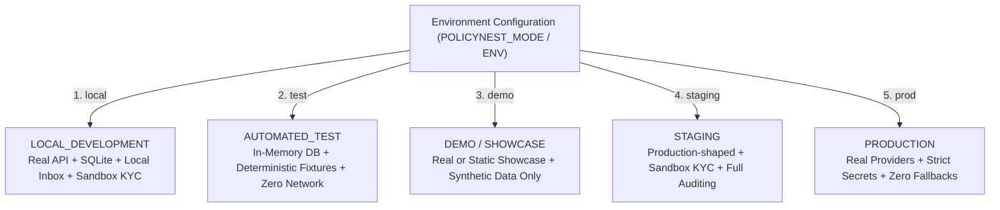

# PolicyNest Environment Modes & Execution Standard

**Author**: Principal DevOps Engineer & Application Security Architect  
**Date**: November 17, 2026  
**Status**: Formal Architectural Standard

---

## 1. Overview of Execution Modes

PolicyNest defines 5 strict, isolated execution modes. Each mode controls authentication behavior, database persistence, external provider routing, logging verbosity, and allowable debugging controls.

---

## 2. Environment Specifications

### Mode 1: `LOCAL_DEVELOPMENT`
- **Purpose**: Full-fidelity day-to-day local engineering, debugging, and review.
- **Backend**: Real Python unified server (`python server.py`) running on `http://localhost:8000`.
- **Database**: Local SQLite file (`policynest.sqlite3`) with WAL journal mode.
- **Authentication**: Real Scrypt password hashing, HttpOnly session cookies, CSRF protection.
- **Email Delivery**: Routed to the **Local Development Inbox** (`GET /api/dev/inbox`). No external SMTP network calls.
- **Document Storage**: Local filesystem (`policynest_mvp/copilot_api/documents_storage/`) outside web root.
- **External Providers**: Deterministic local sandbox adapters (NSDL PAN, UIDAI, NPCI Penny Drop, IRDAI Registry, Malware Scanner).
- **Diagnostics**: Detailed debug logs, active request tracing, developer inspection routes enabled.

### Mode 2: `AUTOMATED_TEST`
- **Purpose**: Continuous Integration (CI) and automated regression test execution.
- **Backend**: Test runner invoking `unittest` or `pytest`.
- **Database**: Isolated temporary in-memory or throwaway file SQLite database. Complete teardown between test cases.
- **Authentication**: Real password hashing with lowered iteration count for test speed, synthetic tokens.
- **Email Delivery**: Captured in test assertions via in-memory mock outbox.
- **External Providers**: Deterministic test fixtures with zero external network connectivity.
- **Assertions**: 215 automated unit and end-to-end tests running in < 70 seconds.

### Mode 3: `DEMO` (Dual Track: Local Demo vs Static Showcase)
- **Local Demo (`python server.py --demo`)**:
  - Real backend + real SQLite database.
  - Seeded with rich, compliant synthetic applicants, reviewers, and audit events.
  - Persistent header badge: `DEMO MODE — SYNTHETIC DATA ONLY`.
  - Accelerated training enabled (`DEMO_TIME_ACCELERATION=true`).
  - Certificates stamped: `DEMO CERTIFICATE — NOT A REAL IRDAI CREDENTIAL`.
  - Admin/QA reset control accessible only via authenticated admin CLI.
- **Static Showcase (GitHub Pages `https://saisidhardy.github.io/PolicyNest/`)**:
  - Deployed static frontend HTML/CSS/WASM.
  - Honest presentation: `Interactive product showcase. Regulated verification integrations are demonstrated in sandbox mode.`
  - Direct credential entry is disabled; users explore using pre-configured synthetic personas.
  - **Zero plaintext password storage in `localStorage`**.

### Mode 4: `STAGING`
- **Purpose**: Pre-production quality assurance, security penetration testing, and compliance sign-off.
- **Backend**: Containerized deployment mirroring production architecture.
- **Database**: Production-grade relational database or managed PostgreSQL.
- **Authentication**: Strict Scrypt / Argon2id password derivation, mandatory MFA for staff roles.
- **External Providers**: Staging sandbox endpoints provided by external verification vendors.
- **Controls**: QA reset buttons permanently compiled out. Real audit trails and centralized logging active.

### Mode 5: `PRODUCTION`
- **Purpose**: Live regulatory operation for insurance policy agent onboarding.
- **Requirements**:
  - Refuses to start if critical environment secrets (`APP_SECRET`, `DATABASE_URL`, provider API keys) are missing.
  - Insecure local fallbacks and demo role switches **strictly compiled out**.
  - All external verification checks route to authorized live endpoints (NSDL, UIDAI, NPCI, IRDAI).
  - Database backed by automated replication, encrypted point-in-time recovery, and immutable audit logs.
  - TLS 1.3 encryption with HSTS and strict CSP headers.

---

## 3. Configuration & Enforcement Matrix

| Feature / Behavior | `LOCAL_DEVELOPMENT` | `AUTOMATED_TEST` | `DEMO` | `STAGING` | `PRODUCTION` |
|:---|:---:|:---:|:---:|:---:|:---:|
| Real SQLite DB | **Yes** | **Yes** (Temp) | **Yes** | **Yes** (or Postgres) | Managed DB |
| Scrypt Password Hashing | **Yes** | **Yes** | **Yes** | **Yes** | **Yes** |
| Local Email Inbox | **Yes** | Test Outbox | **Yes** | External Sandbox | Live SMTP/SES |
| Sandbox KYC Adapters | **Yes** | **Yes** | **Yes** | Partner Sandbox | **Live Regulated** |
| Insecure Local Fallback | **Forbidden** | **Forbidden** | **Forbidden** | **Forbidden** | **Forbidden** |
| Demo Badge Visible | No | No | **Yes** | Optional Banner | **Forbidden** |
| Demo Time Acceleration | Configurable | Yes | **Yes** | No | **Forbidden** |
| Public Role Switcher | **Forbidden** | **Forbidden** | **Forbidden** | **Forbidden** | **Forbidden** |
